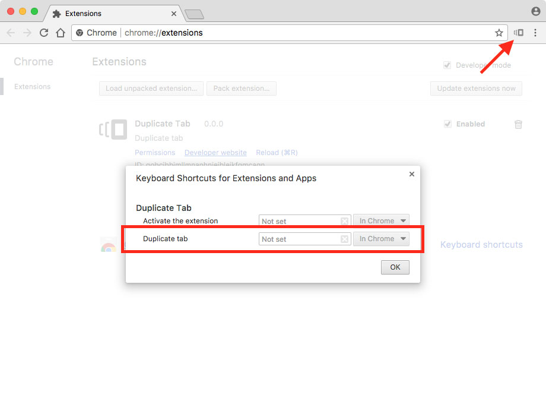

Duplicate Tab
=============

Chrome extension to duplicate the current tab.



## Usage

Click the "Duplicate tab" icon in the Chrome toolbar, or use a keyboard shortcut:

| Action           | Shortcut                                         |
|------------------|--------------------------------------------------|
| Duplicate tab    | <kbd>Alt</kbd> + <kbd>Shift</kbd> + <kbd>D</kbd> |
| Close other tabs | <kbd>Alt</kbd> + <kbd>Shift</kbd> + <kbd>W</kbd> |

"Close other tabs" closes every tab in the current window except the active one.
Pinned and grouped tabs are always spared, and closed tabs can be restored one at
a time with <kbd>Ctrl</kbd> + <kbd>Shift</kbd> + <kbd>T</kbd>.

Sparing groups is a deliberate departure from Chrome's own "Close other tabs",
which closes them: a tab group is something you set aside on purpose, and losing
one whole is worse than leaving a few tabs open.

Both shortcuts can be reassigned at [chrome://extensions/shortcuts](chrome://extensions/shortcuts).

### Using Ctrl+D to duplicate

<kbd>Ctrl</kbd> + <kbd>D</kbd> cannot ship as a default: Chrome reserves it for *Bookmark this page*,
and [browser shortcuts take priority over extension commands](https://developer.chrome.com/docs/extensions/reference/api/commands).
Assigning it manually does work &mdash; open
[chrome://extensions/shortcuts](chrome://extensions/shortcuts), find **Duplicate Tab**, and record <kbd>
Ctrl</kbd> + <kbd>D</kbd> over the default.

That takes the combination away from bookmarking, and Chrome offers no way to move bookmarking elsewhere &mdash; the
shortcuts page only lists extension commands. Bookmarking stays available from the address bar star and the Bookmarks
menu.

## Performance

Consumes minimal resources:

* Uses a Manifest V3 short-lived
  light-weight [service worker](https://developer.chrome.com/docs/extensions/develop/concepts/service-workers/lifecycle#idle-shutdown)
  that only responds to narrow events.
* Requests a single permission, `storage`, used only to remember that the welcome page has been shown.
* Makes no network requests and does not collect analytics.

## Development

Load the repository root as an unpacked extension from
[chrome://extensions](chrome://extensions) with Developer mode enabled.

```sh
npm ci
npm run check   # eslint + type-check JSDoc against @types/chrome
npm run zip     # package for the Chrome Web Store
```

There is no build step &mdash; the sources are loaded by Chrome as-is.

## Third Party Notices

Icon is "[versions](https://primer.style/octicons/versions-24)" from GitHub's
[Octicons](https://primer.style/octicons/), licensed MIT.
